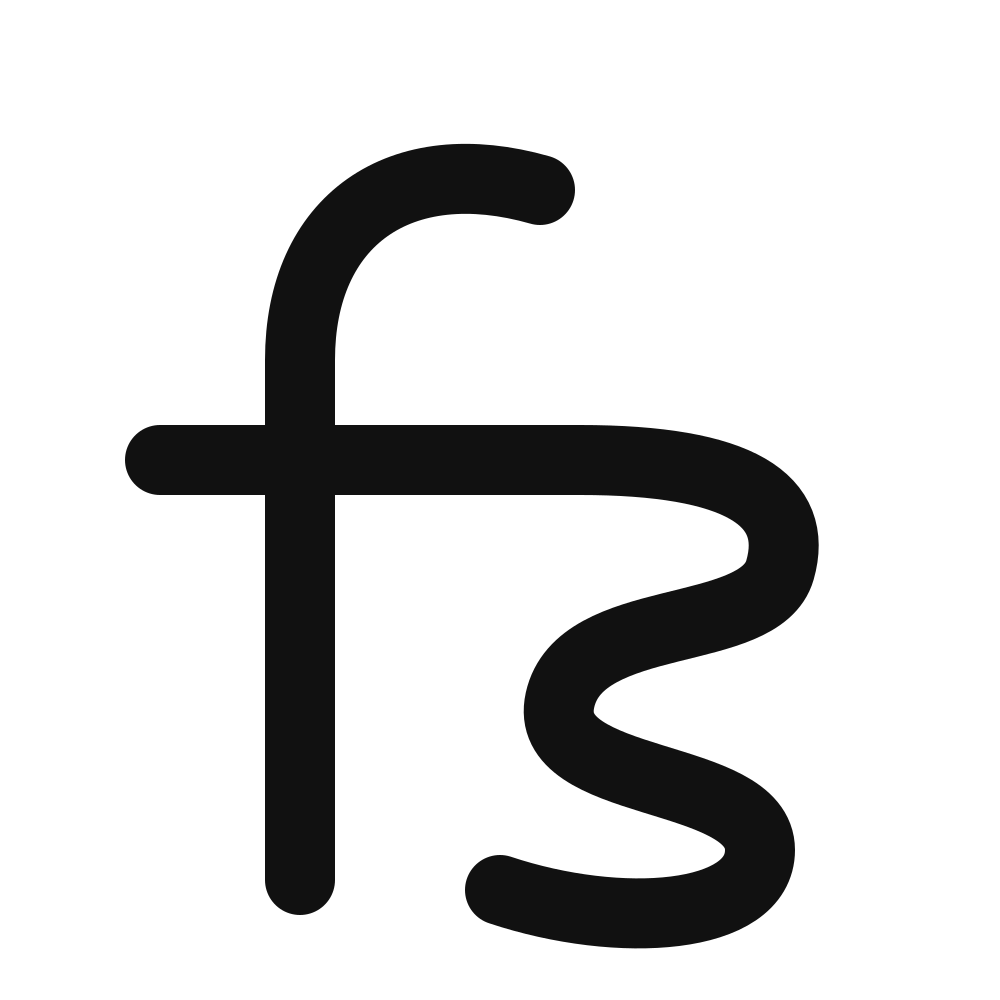
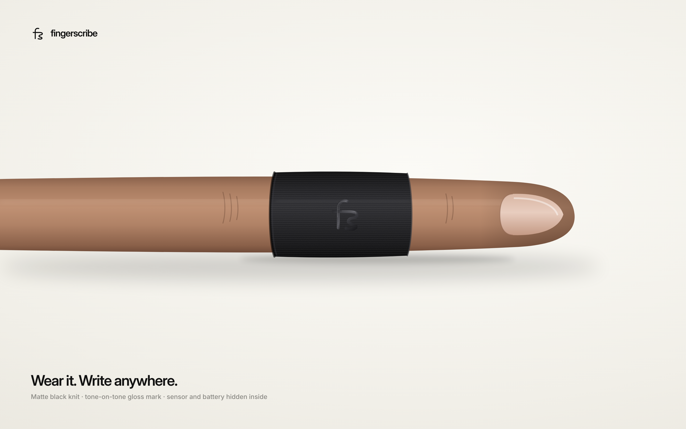
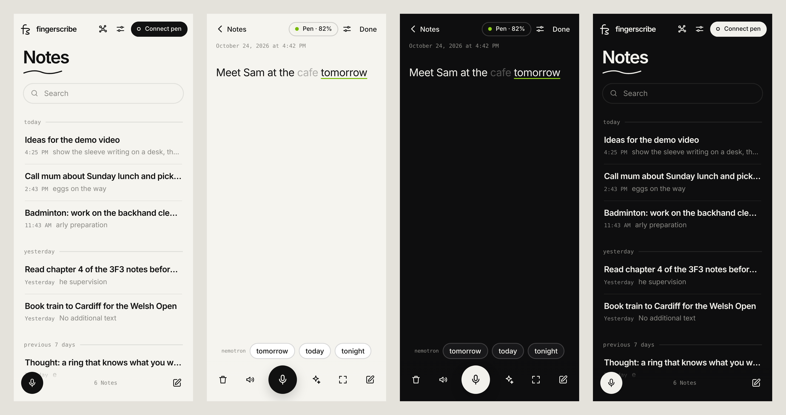
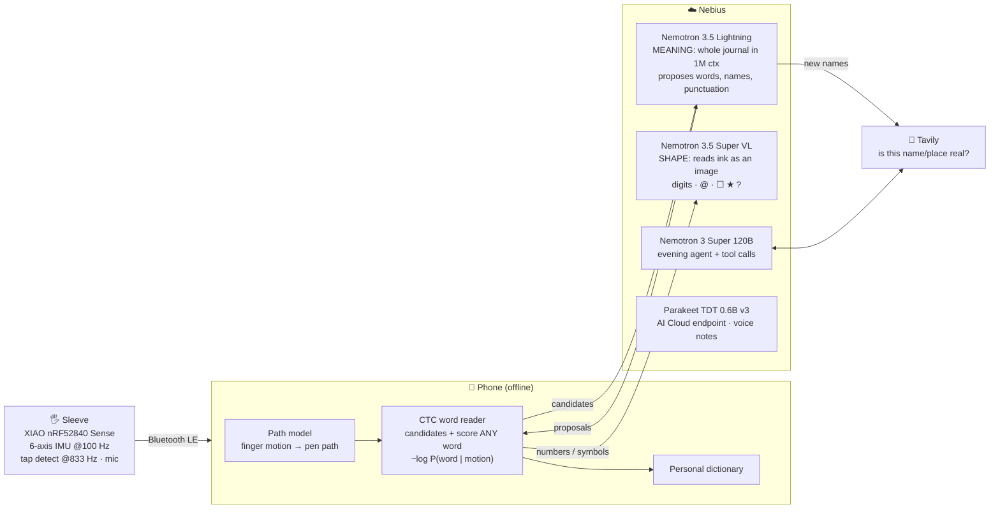

<p align="center">
  
</p>

<h1 align="center">FingerScribe</h1>

<p align="center">
  <b>A finger sleeve for journalling with your eyes up.</b><br>
  Write in your own handwriting on your leg, a desk or inside your pocket. The sleeve turns the motion into text,<br>
  and each evening <b>NVIDIA Nemotron on Nebius</b> hands your day back to you in your own words.
</p>

<p align="center">
  <a href="https://fingerscribe.vercel.app/?demo=1"><b>Try the app</b></a> ·
  <a href="#demo-video"><b>Demo video</b></a> ·
  <a href="docs/JUDGES.md"><b>Judge testing guide</b></a> ·
  <a href="docs/ARCHITECTURE.md"><b>Architecture</b></a> ·
  <a href="docs/HARDWARE.md"><b>Hardware</b></a>
</p>

<p align="center">
  
  
  
  
  <a href="LICENSE"></a>
  <a href="../../actions/workflows/ci.yml"></a>
</p>

<p align="center">
  
  
</p>
<p align="center"><sub>Left: concept render of the production sleeve. Right: the app. The working prototype is shown in the demo video.</sub></p>

---

## The problem

A journal is supposed to keep you present. Mine lived on my phone, the one thing guaranteed to take me out of the moment: a thought lands, I unlock the phone, there's a notification, and the thought is gone.

**FingerScribe catches the thought while your hand is in your pocket and your eyes stay on the world.** No screen, no keyboard and no voice in a quiet room. You write in the air or on any surface with the finger you already have.

## What it does

| | |
|---|---|
| ✍️ **Write anywhere, eyes up** | Print or joined-up, on your thigh on a train, a lecture desk or inside a coat pocket. Text appears on the phone. |
| 🧠 **It writes what you meant** | Misread words fix themselves. Names, places, punctuation, numbers, emails and phone numbers come out right, so you never look down to correct anything. |
| 🛡️ **The AI can't put words in your mouth** | Nemotron only *proposes* words. The phone checks each proposal against your actual finger motion and rejects anything your finger didn't write. |
| 📈 **Gets better the more you wear it** | New names and words join a personal dictionary on the phone and are read offline next time. There is no training task. |
| ☐ **Draw, don't just write** | A box becomes a to-do, a star marks a note, and a `?` saves a question for tonight. |
| 🎧 **Talk mode** | With headphones in, write or speak to FingerScribe. It replies in your ear, remembers your journal and looks things up with Tavily. |
| 🌙 **Your day, handed back** | In the evening you get one entry in your words with your real strokes underneath. It also shows what you've written before, answers to your `?` questions, your to-dos and contacts, and one question to sit with. |
| 📴 **Offline-first** | Capture and handwriting reading run on the phone. If the network drops, notes are saved with the reader's best guess and fixed when it comes back. |
| 🧥 **Pocket mode** | No phone nearby? The sleeve stores about 20 minutes of writing in its own flash and syncs it the next time it connects. |

## Demo video

▶️ **[Watch the 3-minute demo on YouTube](https://youtu.be/d5RBfHMUGaM)**. It includes over a minute of the real sleeve on a finger, writing.

## How NVIDIA Nemotron and Nebius are used

Every word has **three witnesses**. The cloud proposes and the phone verifies.



| Model | Job in FingerScribe | Why this size and variant | Where in the code |
|---|---|---|---|
| **`nvidia/Nemotron-3_5-Lightning`** (30B, 3B active) | Proposes the words you meant, with names, places and punctuation. Also runs Talk mode and turns spoken numbers into written form. | It holds 1M tokens of context at small-model speed and price, so the **whole journal sits behind every sentence** for about $0.002 a call, and Talk mode still answers instantly. | [`witnesses`](app/index.html#L2510), [`talk`](app/index.html#L2603) |
| **`nvidia/Nemotron-3.5-Super-VL`** | Reads digits, `@`, `.`, `+` and drawn symbols from a rendered image of the ink. | Our motion reader only knows a–z, so a vision model reads the shape. It is called only when a word looks like a number, email or symbol. | [`witnesses`](app/index.html#L2510) |
| **`nvidia/nemotron-3-super-120b-a12b`** (12B active) | Evening agent. It decides what to look up, calls Tavily as a tool, then writes the entry, the answers, the to-dos and contacts, and one question. | It needs strong reasoning and tool calling, and it runs once a day, so we pay for quality there. | [`day`](app/index.html#L2664) |
| **NVIDIA Parakeet TDT 0.6B v3** | Transcribes hold-to-talk voice notes from the sleeve's 8 kHz mic. | Open weights, fast, accurate. Packaged as a scale-to-zero **Nebius AI Cloud serverless endpoint**. | [`cloud/asr`](cloud/asr) |
| **Tavily** | Confirms new names and places before they join your dictionary, answers your questions with sources, and works as a tool in Talk mode and the evening agent. | Live web knowledge with citations. | [`webSearch`](app/index.html#L2490) |

**Nebius platform used:**
- **Token Factory** serves all three Nemotron models behind one OpenAI-compatible API, through a locked-down proxy ([`app/api/nebius.js`](app/api/nebius.js), [`app/serve.py`](app/serve.py)). The proxy accepts Nemotron models only, two endpoints only and capped output, and the key never reaches the browser.
- **AI Cloud Serverless Endpoints** run Parakeet speech-to-text ([`cloud/asr`](cloud/asr)).
- **AI Cloud Serverless Jobs** run the reader's training pipeline. Lightning writes the training corpus, then the job synthesises motion and trains ([`cloud/training`](cloud/training)).
- **Prompt caching by design:** the journal is the same first block of every Lightning call ([`journalText`](app/index.html#L2476)), so Token Factory can reuse it.

> **Why this design matters:** a language model is most useful to a sensor when the sensor can veto it. Nemotron supplies the meaning (your friend's name, the café you mean), and the physics of your finger supplies the ground truth. A sensible-sounding word that your finger didn't write is rejected.

**What this is not:** it is pseudo-labelling with an LLM proposer and a physical verifier, not reinforcement learning. The app keeps a fix log (*Settings → Copy fix log*), so you can check how often a fix was right.

## Results

One writer, measured. Every number comes from data the model never saw.

| What | Result | How measured |
|---|---|---|
| Pen-path reconstruction error | **≈ 2 mm** (WritingRing, the closest research system, reports 1.6 mm) | Against ground-truth pen paths on unseen writing; 200k-parameter network |
| Word reader, normal-speed print, unseen words | **68 / 80 words (85%)**, letter error 17% | 2-fold; each word tested by a model that never saw that recording |
| On-phone JavaScript port vs TensorFlow | **max logit difference 0.00000** | Same recordings through both |
| Read time per word on the phone | **0.1–0.35 s** | Measured in the app, per word |

**What didn't work** (we're keeping a record of it):
- A reader trained on simulated finger motion alone read **0%** of real words.
- Pen-only datasets (OnHW) transferred poorly to a finger.
- A vibration-based touch detector missed quick lifts.
- The only thing that reliably raised accuracy was more real writing from the actual writer. That's why the app keeps every stretch you write.

## Quick start

### Judges: no hardware needed (2 minutes)

1. Open **[fingerscribe.vercel.app/?demo=1](https://fingerscribe.vercel.app/?demo=1)** in Chrome. `?demo=1` loads a sample journal.
2. Tap 🎧 **Talk**, hold the mic and ask *"what book did Sam recommend?"*. Lightning answers from the journal and calls Tavily when it needs a fact.
3. Tap 🌙 **Your day**. Nemotron 3 Super writes the evening entry, looks up and answers the saved question (*"how long does it take to form a habit?"*) and pulls out to-dos.

The full walkthrough, including what to look for and how to check the model calls, is in **[docs/JUDGES.md](docs/JUDGES.md)**.

### Run the app locally

Requires Python 3.9 or newer, standard library only.

```bash
git clone https://github.com/IsumNA/FingerScribe.git
cd FingerScribe/app
export NEBIUS_API_KEY=...        # Nebius Token Factory key (Windows: set NEBIUS_API_KEY=...)
export TAVILY_API_KEY=...        # optional
python serve.py                  # Windows: double-click start.bat
# -> http://localhost:8000   and it prints "Nemotron on Nebius Token Factory: OK - ..."
```

### Deploy your own (Vercel)

```bash
cd app
npx vercel
npx vercel env add NEBIUS_API_KEY        # also TAVILY_API_KEY, PARAKEET_URL, PARAKEET_TOKEN (optional)
npx vercel --prod
# check: https://<your-app>/nebius/health  ->  {"key":true}
```

### Build the sleeve

Flash [`firmware/fingerscribe_ble/fingerscribe_ble.ino`](firmware/fingerscribe_ble/fingerscribe_ble.ino) to a Seeed XIAO nRF52840 **Sense**. Add a LiPo and a push button between D1 and GND, open the app in Chrome (Android, Windows, macOS) or Bluefy (iPhone), and tap **Connect pen**. The parts list, wiring and Bluetooth protocol are in [docs/HARDWARE.md](docs/HARDWARE.md).

### Nebius AI Cloud

- Speech-to-text endpoint: [`cloud/asr/README.md`](cloud/asr/README.md)
- Training job: [`cloud/training/README.md`](cloud/training/README.md)

## Weights

The trained on-phone models (`model.json`, `letters.json`, `words_reader.json`, `touch.json`) and the sleeve recordings are **not in this repo**, because we're taking FingerScribe to market. Everything else is open under MIT: the app, the proxies, the firmware, the Parakeet endpoint and the training pipeline.

- The **live app** serves the models, so every feature can be tested there.
- A local clone runs the full UI, Talk mode, Your day, voice notes and every Nemotron, Parakeet and Tavily call. Only reading handwriting from the sleeve needs the weights. `serve.py` tells you if they're missing.
- To train your own, run the [training job](cloud/training) on your recordings. Judges can request the weights by email for verification.

## Repository layout

```
app/                    The app: one HTML file (installable web app), no build step
├── index.html          UI, Bluetooth, on-phone path model + CTC reader, Nemotron/Tavily logic
├── api/                Vercel serverless proxies: nebius.js · tavily.js · asr.js
├── serve.py            Same proxies for local use (Python standard library only)
├── vocab.json, words.json, wordpairs.json   English word frequencies / word-pair counts
└── vercel.json, manifest.webmanifest, start.bat
firmware/
└── fingerscribe_ble/   Arduino firmware: IMU streaming, on-chip tap detect, mic (ADPCM), battery, BLE UART
cloud/
├── asr/                NVIDIA Parakeet on a Nebius AI Cloud serverless endpoint (Dockerfile + FastAPI)
└── training/           Reader training as a Nebius AI Cloud serverless job (Nemotron-written corpus → train)
docs/                   Judge guide, architecture, hardware, images
```

## What's new for this hackathon

The hackathon began on 26 August 2026. Before that, FingerScribe was a motion sensor on a finger and a letter classifier that could read big, slow letters one at a time.

**Built during the hackathon:**
- Every use of Nebius and NVIDIA models: the Nemotron word proposals with motion verification, the per-writer letter prior, the Super VL doodle and number reader, Talk mode, the evening agent, the Parakeet endpoint and the training job.
- The whole-word CTC reader.
- Hold-to-talk on the sleeve, on-chip tap detection and the app redesign.

## Privacy and security

- API keys stay server-side: Vercel environment variables or a local file, both gitignored.
- The proxy accepts **Nemotron models only**, two endpoints only, with `max_tokens ≤ 2000`, so a leaked app link can't spend the key on anything else.
- Notes live in the browser's local storage on your phone. The cloud sees only the text needed for each call (plus a rendered ink image for numbers and symbols). Raw motion data never leaves the phone.

## Roadmap

- A thinner sleeve with an enclosed battery and wireless charging (Sofia's design, shown in the render above).
- More writers, left-handed testing, and published per-writer heal-rate curves.
- A pilot with people who used to keep a journal and stopped.
- On-device Nemotron for the per-word step once a phone or Jetson-sized model exists.

## Team

| | |
|---|---|
| **Isum Nanomi-Arachchige** | Software, sensing, ML |
| **Sofia Hametsina** | Product design, prototyping, hardware |

## Acknowledgements

[NVIDIA Nemotron](https://www.nvidia.com/en-us/ai-data-science/foundation-models/nemotron/) and [Parakeet](https://huggingface.co/nvidia/parakeet-tdt-0.6b-v3) · [Nebius Token Factory and AI Cloud](https://nebius.com) · [Tavily](https://tavily.com) · [Seeed XIAO nRF52840 Sense](https://wiki.seeedstudio.com/XIAO_BLE/) · handwriting generation from [sjvasquez/handwriting-synthesis](https://github.com/sjvasquez/handwriting-synthesis) (IAM-OnDB) · [OnHW](https://www.iis.fraunhofer.de/de/ff/lv/dataanalytics/anwproj/schreibtrainer/onhw-dataset.html) dataset · [wordfreq](https://github.com/rspeer/wordfreq).

## License

[MIT](LICENSE) © 2026 Isum Nanomi-Arachchige and Sofia Hametsina. Third-party models keep their own licences: NVIDIA Open Model License for Nemotron and Parakeet.
