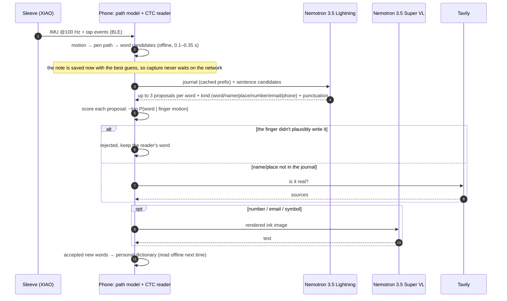

# Architecture

FingerScribe splits work three ways. The **sleeve** senses, the **phone** reads and verifies, and **Nebius** supplies meaning.

## The three witnesses

1. **Motion (phone).** A ~200k-parameter network rebuilds the fingertip's pen path from the IMU. A CTC word reader then produces candidates and, most importantly, can score *any* string against the recorded motion. Both are ported to plain JavaScript and match TensorFlow to 0.00000 max logit difference.
2. **Meaning (Lightning).** It gets the whole journal (up to 120k characters) as the first block of every call, then the current sentence's candidates. It returns JSON proposals. Lightning has a 1M context and is cheap per token, so one call per sentence is affordable (about $0.002 with a 30k-token journal).
3. **Shape (Super VL).** The reader only knows a–z. When a word looks like a number, email, phone number or doodle, the strokes are rendered to an image and read by the vision model.

A proposal is accepted only if the motion score agrees. This is what lets an LLM edit a personal journal safely.

## Learning per writer, without training

- **Personal dictionary:** names and words that are accepted (and checked with Tavily) join an on-phone lexicon and are read offline next time.
- **Letter prior:** the phone counts which of *your* letters get misread, and these confusions go back into the Lightning prompt.
- **Fix log:** *Settings → Copy fix log* records every change, so the heal rate and accuracy can be audited.

## Agents

| Agent | Model | Tools | Frequency |
|---|---|---|---|
| Talk | Lightning | Tavily search (the model decides when) | per turn |
| Evening "Your day" | Nemotron 3 Super 120B-A12B | Tavily search | once a day |

Both use a small tool loop with no agent framework ([`agent()`](../app/index.html#L2605)), over Token Factory's OpenAI-compatible tool calling.

## Serving

| Path | Local (`app/serve.py`) | Hosted (`app/api/*.js`, Vercel) | Upstream |
|---|---|---|---|
| `/nebius/*` | ✓ | ✓ | Nebius Token Factory: Nemotron only, `/models` and `/chat/completions` only, `max_tokens ≤ 2000` |
| `/tavily/search` | ✓ | ✓ | Tavily, basic depth, ≤ 5 results |
| `/asr` | ✓ | ✓ | Parakeet on a Nebius AI Cloud endpoint ([`cloud/asr`](../cloud/asr)) |

## Training (Nebius AI Cloud job)

[`cloud/training`](../cloud/training) runs four steps:
1. Lightning writes about 20k journal-style fragments.
2. A handwriting generator (IAM-OnDB, 13 styles) turns them into pen paths, and a finger simulator turns the paths into IMU signals.
3. The reader is pretrained on the simulated data plus OnHW, then fine-tuned on real recordings.
4. The weights are exported and the held-out writing is scored.

The simulator, the recordings and the weights are private.
